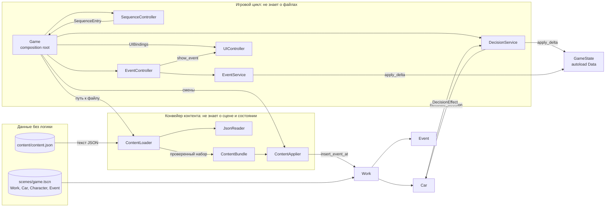
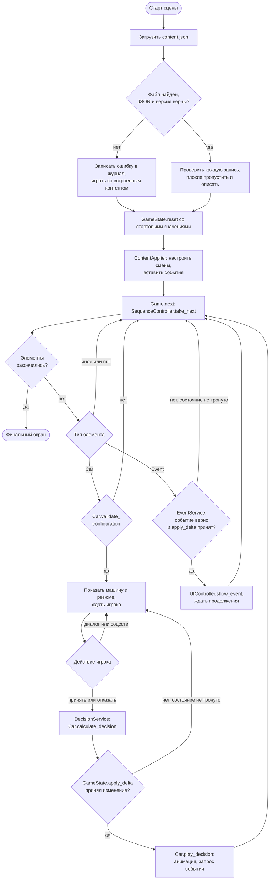
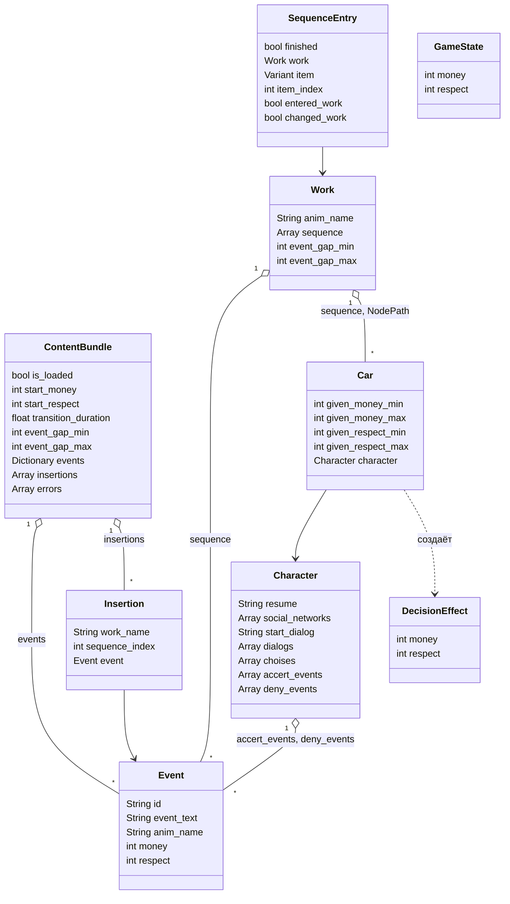
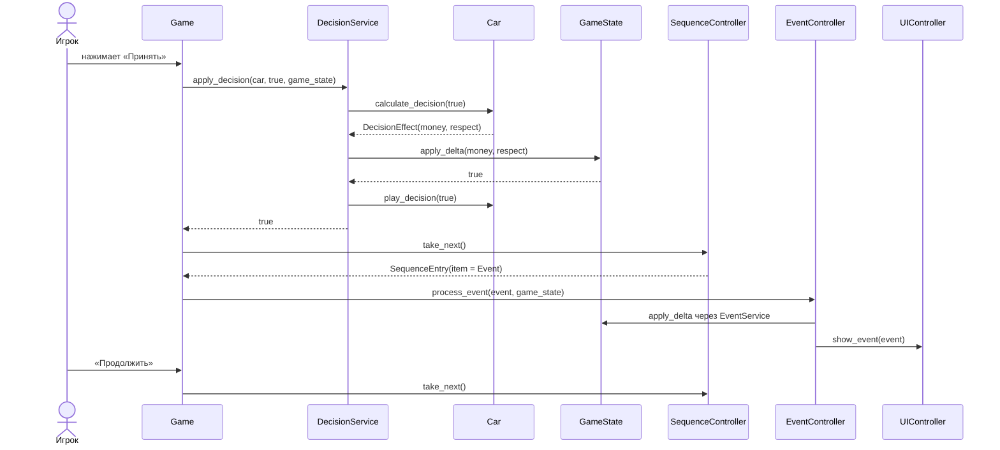

# Архитектура АЗС

Документ описывает центральный игровой цикл «действие игрока → результат», границы модулей,
данные и реакцию на ошибочные данные. Как добавить элемент через данные — в
[content_guide.md](content_guide.md).

## 1. Центральный цикл

Игрок видит посетителя (машину), изучает резюме, соцсети и диалог, затем принимает или
отклоняет его. Решение меняет деньги и репутацию, после чего игра выдаёт следующий элемент
смены: машину или текстовое событие. Когда элементы всех смен закончились, показывается финал.

## 2. Архитектурный граф



Правило зависимостей: стрелки идут только от потребителя к поставщику. `Game` — единственное
место сборки: он знает пути к узлам сцены (`_build_ui_bindings`) и путь к файлу контента, а
остальные модули получают всё через аргументы и `setup()`.

## 3. Блок-схема алгоритма



## 4. Схема данных



### Формат файла `content/content.json` (версия 1)

| Поле | Тип | Обязательно | Диапазон и смысл |
|---|---|---|---|
| `format_version` | целое | да | Только `1`. Иначе файл целиком отклоняется |
| `settings.start_money` | целое | нет | 0…100 000 000, по умолчанию 0 |
| `settings.start_respect` | целое | нет | −100 000 000…100 000 000, по умолчанию 0 |
| `settings.transition_duration` | число | нет | 0…3 секунды; без поля берётся значение из сцены |
| `settings.event_gap_min` / `event_gap_max` | целое | нет | 1…10, по умолчанию 2 и 3; `min` не больше `max` |
| `events[].id` | строка | да | Уникальный идентификатор, не пустой |
| `events[].text` | строка | да | Текст события, не пустой, `\n` — перенос строки |
| `events[].animation` | строка | нет | Имя анимации в `AnimationPlayer`; нет такой — анимации нет |
| `events[].money` / `respect` | целое | нет | −1 000 000…1 000 000, по умолчанию 0 |
| `insertions[].work` | строка | да | Имя узла смены в сцене (`Work`, `Work2`) |
| `insertions[].event` | строка | да | `id` события из `events` |
| `insertions[].position` | целое | нет | Индекс в последовательности смены; −1 или за концом — в конец |

Заполненный пример — [content/content.json](../content/content.json).

## 5. Модули: ответственность, входы, выходы

| Модуль | Ответственность | Вход | Выход | Зависит от |
|---|---|---|---|---|
| `Game` | Сборка систем, ожидание действий игрока, переходы | Сигналы кнопок и диалога, файл контента | Вызовы систем | Все модули |
| `ContentLoader` | Чтение и проверка JSON | Путь или текст | `ContentBundle` | `JsonReader`, `Event`, `GameState` (константы) |
| `JsonReader` | Типизированное чтение полей с диапазонами | `Dictionary`, ключ, границы | Значение или значение по умолчанию + сообщение | — |
| `ContentApplier` | Настройка смен и вставка событий | `ContentBundle`, смены | Список пропущенных вставок | `Work` |
| `SequenceController` | Порядок смен и элементов | Список `Work` | `SequenceEntry` | `Work` |
| `DecisionService` | Применение решения игрока | `Car`, действие, `GameState` | `bool`; побочный эффект только через `GameState` | `Car`, `GameState` |
| `EventService` | Проверка события и применение эффекта | `Event`, `GameState` | `bool` | `Event`, `GameState` |
| `EventController` | Применение эффекта, затем показ | `Event`, `GameState` | `bool` | `EventService`, `UIController` |
| `UIController` | Показ экранов, доступность кнопок | `UIBindings` | Изменения интерфейса | `UIBindings` |
| `GameState` | Деньги и репутация, атомарные изменения | Дельты | `bool`, сигнал `state_changed` | — |
| `Work`, `Car`, `Character`, `Event` | Данные и поведение объекта | Экспортируемые поля | — | — |

## 6. Типовой сценарий



## 7. Места настройки

| Что настраивается | Где | Пример |
|---|---|---|
| События и их эффекты | `content/content.json` → `events` | `money: 20` |
| Где событие появляется | `content/content.json` → `insertions` | `work: Work2, position: 2` |
| Стартовые деньги и репутация | `content/content.json` → `settings` | `start_money: 50` |
| Длительность затемнения | `settings.transition_duration` или экспорт `Game` | `0.5` |
| Задержка случайных событий | `settings.event_gap_min` / `event_gap_max` | `2` и `3` |
| Награда за решение | экспорт `Car` в сцене | `given_money_min = 10` |
| Диалоги, резюме, соцсети | ресурсы `Character`, `LinearDialog`, `Choise` | — |
| Порядок машин и событий в смене | массив `sequence` у `Work` в сцене | — |
| Путь к файлу контента | экспорт `Game.content_path` | `res://content/content.json` |

## 8. Ошибочные и граничные данные

Принцип: данные проверяются до применения, плохая запись пропускается и описывается в журнале,
`GameState` меняется только целиком или не меняется совсем.

| Ситуация | Реакция | Состояние игры | Проверка |
|---|---|---|---|
| Файла нет, пустой текст, битый JSON, корень не объект | Сообщение об ошибке, игра идёт со встроенным контентом | Не тронуто | `_test_loader_broken_text` |
| Неподдерживаемая версия формата | Файл не используется | Не тронуто | `_test_loader_broken_text` |
| Запись без `text`, дробные или огромные числа, повтор `id`, не объект | Запись пропущена, остальные загружены | Не тронуто | `_test_loader_invalid_file` |
| Настройка вне диапазона, `event_gap_min` больше `max` | Значение по умолчанию + сообщение | Не тронуто | `_test_loader_invalid_file` |
| Вставка с неизвестным событием или индексом меньше −1 | Вставка пропущена | Не тронуто | `_test_loader_invalid_file` |
| Вставка в несуществующую смену | Пропущена, сообщение в журнал | Не тронуто | `_test_applier_on_invalid_file` |
| Индекс вставки за концом последовательности | Вставка в конец | Не тронуто | `_test_applier_on_invalid_file` |
| Эффект уводит деньги в минус | `apply_delta` возвращает `false`, событие или решение не применяется | Не меняется ни одно из значений | `_test_game_state`, `_test_services_keep_state` |
| Изменение или значение выше предела | Отклонено | Не тронуто | `_test_game_state` |
| Машина без `Character`, событие без текста, `null` | Отклонено сервисом | Не тронуто | `_test_services_keep_state` |

Запуск проверок (нужен Godot 4.7):

```bash
godot --headless --path . --import
godot --headless --path . --script res://tests/test_runner.gd
```

Код возврата 0 — все проверки пройдены. Предупреждения `WARNING:` в выводе ожидаемы: это
реакция модулей на специально испорченные данные.

## 9. Расширение через данные

Новый элемент существующего типа (`Event`) добавляется правкой `content/content.json` без
изменения GDScript и сцены. Пошаговая инструкция, исходный и изменённый файлы и ожидаемый
результат в игре — в [content_guide.md](content_guide.md).

## 10. Что осталось вне рамок

- Новые посетители (`Car` + `Character` + диалоги) по-прежнему создаются в редакторе сцены:
  им нужны 3D-узел и анимации. Через данные добавляются события, их эффекты, позиции и настройки.
- Состояние `Game` по-прежнему хранится в нескольких булевых флагах; явный автомат состояний
  был бы следующим шагом.
- Для сборки (экспорта) файл `content.json` нужно добавить в фильтр экспорта «Include non-resource
  files» (`*.json`).

## 11. Определение концовки

Когда `SequenceController` сообщает `SequenceEntry.finished`, `Game` завершает игровую последовательность и передаёт итоговые деньги и репутацию сервису `Endings`.

`Endings` — независимый сервис без доступа к сценам и без права изменять `GameState`. Он возвращает идентификатор результата по двум порогам:

1. Если деньги не ниже `money_ending_threshold`, выбирается финансовая концовка.
2. Иначе, если репутация не ниже `respect_ending_threshold`, выбирается репутационная концовка.
3. Иначе выбирается неудачная концовка.

Если достигнуты оба порога, финансовая концовка имеет приоритет.

Пороги и ссылки на сцены экспортированы в `Game` и настраиваются в Inspector в группе **Концовки**. Начальные значения: 10 000 денег и 100 репутации. Для каждого исхода используется отдельная сцена:

- `scenes/endings/ending_rich.tscn` — финансовый успех;
- `scenes/endings/ending_respect.tscn` — уважение жителей;
- `scenes/endings/ending_failure.tscn` — ни один порог не достигнут.

Существующие сцены `ending_fuel.tscn`, `ending_money.tscn` и `ending_reputation.tscn` сохраняют прежнее назначение: это аварийные финалы при исчерпании соответствующего ресурса во время игры.
