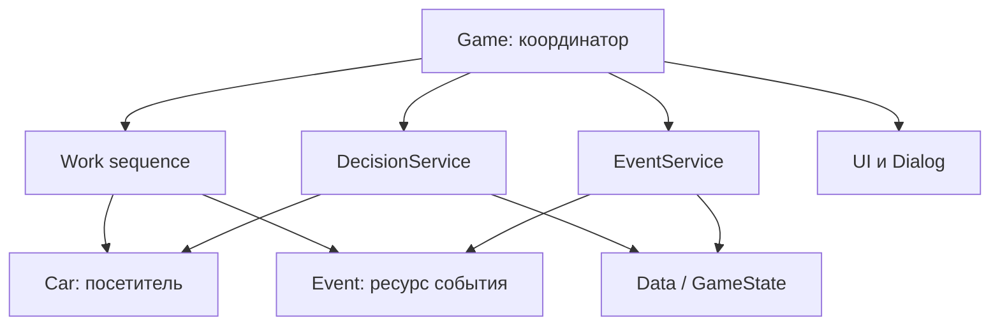
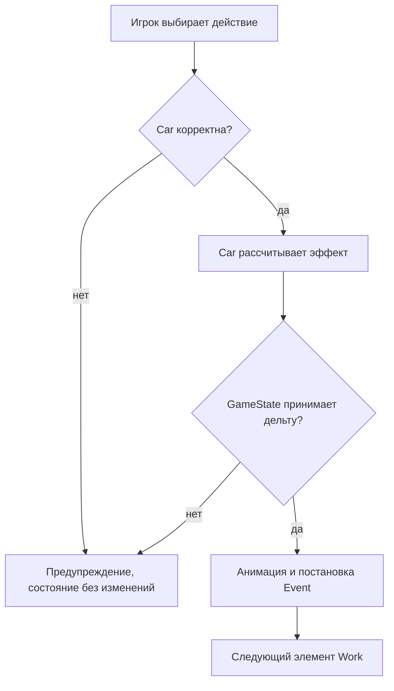
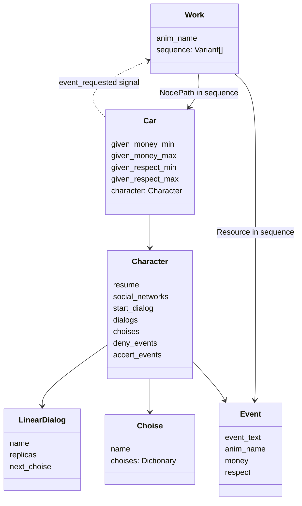

# Архитектура игрового цикла

## Архитектурный граф



## Блок-схема решения



## Схема данных



## Контракты модулей

| Модуль | Вход | Выход / эффект |
|---|---|---|
| Game | Сигналы UI, Work[] | Выбор следующего элемента и вызов сервиса |
| Work | Индекс последовательности | Car или Event; проверка и вставка события |
| Car | Принятое решение | Словарь дельт; визуальная анимация после успешного применения |
| DecisionService | Car, решение, GameState | Атомарное применение дельт |
| EventService | Event, GameState | Атомарное применение эффекта события |
| Data | money_delta, respect_delta | Новые значения или отказ без частичного обновления |
| Character | Данные персонажа | Валидация структуры диалогов и выборов |

## Точки настройки

- Награды за согласие: экспортируемые диапазоны в узле Car.
- Содержимое персонажа: Resource Character и вложенные LinearDialog / Choise.
- Текст и эффект события: Resource Event.
- Порядок посетителей и событий: массив sequence у Work.
- Порядок рабочих смен: массив works у Game.

## Пример расширения

Исходного кода обработчиков менять не требуется. Создайте ресурс Event, задайте текст/анимацию/изменения состояния и добавьте ресурс в sequence существующего Work. Пример заполненного ресурса — content/events/donation.tres.

## Контролируемые ошибки

| Вход | Реакция |
|---|---|
| Car без Character | Машина пропускается |
| Неверный диапазон награды | Решение отклоняется |
| Event без текста | EventService отклоняет событие |
| Несуществующий NodePath | Work выдаёт предупреждение, Game пропускает элемент |
| Отрицательный итоговый баланс | Data отклоняет оба изменения |
| Несуществующая ссылка на диалог/выбор | Character не проходит валидацию, диалог не запускается |

Отказ от операции не должен менять деньги и репутацию частично.

## Исходный и расширенный вариант данных

До расширения в смене использовались только уже подготовленные события и машины. Тип ресурса Event уже существовал, поэтому новый тип и новый обработчик не понадобились.

Условный исходный ресурс того же типа:

```ini
[resource]
script = ExtResource("event_script")
event_text = "Поставки топлива задерживаются."
anim_name = "default"
money = 0
respect = -5
```

Новый ресурс content/events/donation.tres:

```ini
[resource]
script = ExtResource("1_event")
event_text = "Местные жители собрали деньги на помощь станции."
anim_name = "default"
money = 500
respect = 15
```

Новый ресурс подключён к sequence узла Work2 в scenes/game.tscn. Таким образом, новый элемент уже присутствует в игровом сценарии и появляется после двух машин этой смены. Изменения GDScript для добавления этого конкретного события не потребовались.

## Автоматическая проверка состояния

Из корня проекта выполните:

```bash
godot --headless --path . --script res://tests/test_game_state.gd
```

Тест проверяет успешное применение дельты, отказ при отрицательном балансе, применение валидного Event и отсутствие частичного изменения состояния при невалидном Event.
