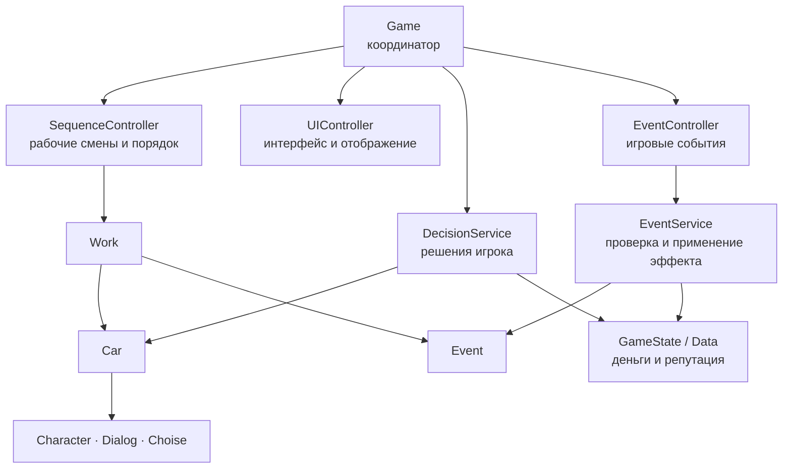

# Архитектура игрового цикла

## Архитектура верхнего уровня

## Ответственность компонентов

| Компонент | Ответственность |
|---|---|
| Game | Composition root: создаёт системы, передаёт им зависимости, связывает сигналы и запускает игровой цикл |
| SequenceController | Хранит индексы смены и элемента, выдаёт следующий элемент с учётом динамической вставки событий |
| UIController | Показывает резюме, социальные сети, события и финальный экран; управляет отображением UI и доступностью кнопок |
| DecisionService | Рассчитывает и атомарно применяет последствия решения игрока |
| EventController | Координирует применение эффекта события и его показ через UIController |
| EventService | Валидирует Event и применяет его числовые эффекты |
| GameState (autoload Data) | Хранит деньги и репутацию; изменяет их только через apply_delta() |
| Work | Содержит последовательность Car и Event, валидирует её и вставляет запрошенные события |
| Car | Проверяет собственные данные, рассчитывает эффект решения и запускает анимацию после успешного применения |
| Character, LinearDialog, Choise, Event | Конфигурационные ресурсы игрового контента |

## Поток принятия решения

1. Игрок нажимает одну из кнопок, обработчик вызывает Game.
2. Game передаёт Car и выбранное действие в DecisionService.
3. DecisionService получает расчёт от Car.calculate_decision().
4. GameState.apply_delta() атомарно изменяет деньги и репутацию.
5. После успешного применения DecisionService запускает Car.play_decision().
6. Game запрашивает следующий элемент у SequenceController.

## Поток события

1. SequenceController получает Event из текущего Work.
2. Game передаёт событие в EventController.
3. EventController вызывает EventService для проверки и применения эффекта.
4. После успешного применения EventController поручает UIController показать событие.
5. Game ожидает продолжения игрока и затем запрашивает следующий элемент.

## Данные и конфигурации

Существующие ресурсы Character, Car, Event, Work, LinearDialog и Choise сохранены. Их экспортируемые поля и ссылки в сценах не требуют переноса в контроллеры. Work остаётся Node3D и по-прежнему хранит NodePath на Car и Resource Event.

## Настройка контента

- Награды за согласие/отказ: экспортируемые диапазоны в Car.
- Диалоги и реплики: ресурсы Character и LinearDialog.
- Варианты ответов: ресурс Choise.
- Текст и эффекты события: ресурс Event.
- Порядок машин и событий: массив sequence у Work.
- Порядок смен: массив works у Game.

## Границы зависимостей

Системы получают зависимости через setup() или аргументы методов. Они не ищут Autoload самостоятельно. Game является единственной точкой сборки (composition root), передаёт Data как GameState и связывает контроллеры между собой.
